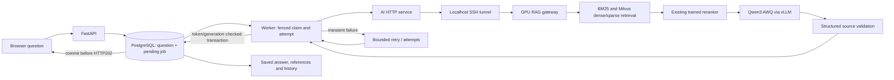

# Architecture

## Ownership and durability

The API atomically commits input and job before acceptance. Idempotency keys and a uniqueness constraint protect concurrent duplicates. Workers claim with a UUID token and increasing generation. Heartbeats, lease recovery and token-checked completion fence obsolete owners. Model execution remains at-least-once: a crash can repeat GPU work; fenced writes protect saved state, not exactly-once generation.

## Real AI boundary

The gateway uses original BM25, BGE-M3 dense/sparse retrieval, trained reranking and the fine-tuned 4-bit Qwen3 model via vLLM. Generated steps must cite IDs from the actual candidate packet. Gateway and application validate manual identity, PDF hash, valid pages, excerpt checksums and cited steps before persistence.

The live A100 used Python3.12.13, torch2.7.0+cu126, vLLM0.9.0.1, transformers4.51.1 and pymilvus2.5.9. Local containers use Python3.11. The environments were not merged or blindly upgraded.

## Target-only repair

All1571 copied files first matched their source SHA256. A separate copy of genuine Mongo data exported6102 documents. The original embedding/retriever rebuilt6102 vectors. The measured maximum chunk was5657 UTF8 bytes; text length became8192. The gateway reads the existing VARCHAR schema rather than assuming512. Staging uses the `.db` suffix accepted by pymilvus.

COUNT queries observed0 before repair,6102 after, and0 after executing rollback on a separate copy, with exact baseline hash recovery and binary patch reconstruction. Only then was the repaired release deployed. Milvus opens a writable runtime copy; managed Mongo uses `runtime/mongo`. Original source `infer.py` and `src/` were not edited.

## Signals and boundaries

Liveness is separate from readiness. Missing assets or a broken tunnel yield unavailable readiness, never a fabricated fallback. JSON events, attempts, API metrics, gateway completion logs and vLLM request/token counters expose separate stages. Historical simulation adapters remain explicitly labelled in separate projects; no automatic fallback is enabled. Legacy W07 data stay readable without invented provenance. Public multi-user authorization and a measured factual benchmark are outside this prototype.

## Startup acceptance boundary

The Remote launcher requires API/database/RAG ready and live mode after container health checks; configuration-only preflight is not runtime acceptance. A separate clean checkout/database verifier submits a fresh real question and checks queued SQL, restart and idempotency without reusing the development database. The GPU remains an explicitly provisioned private dependency. See ADR0007 and [reproduction](reproducibility.md).
