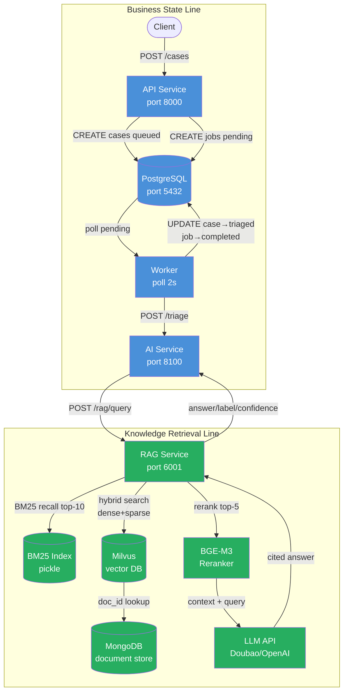
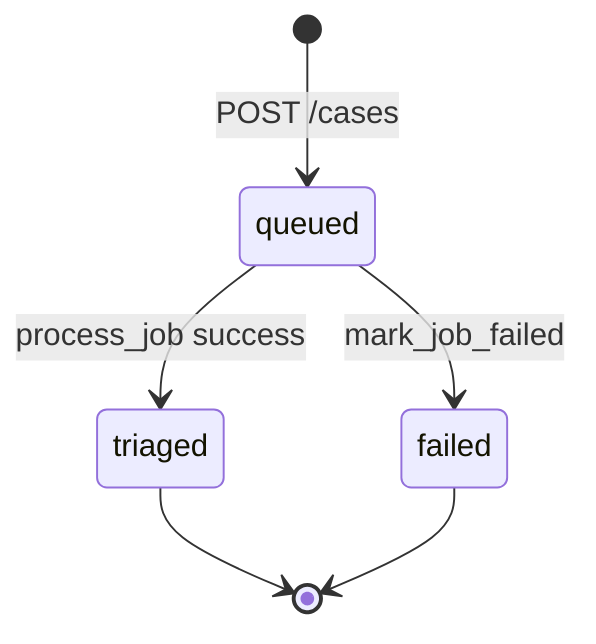
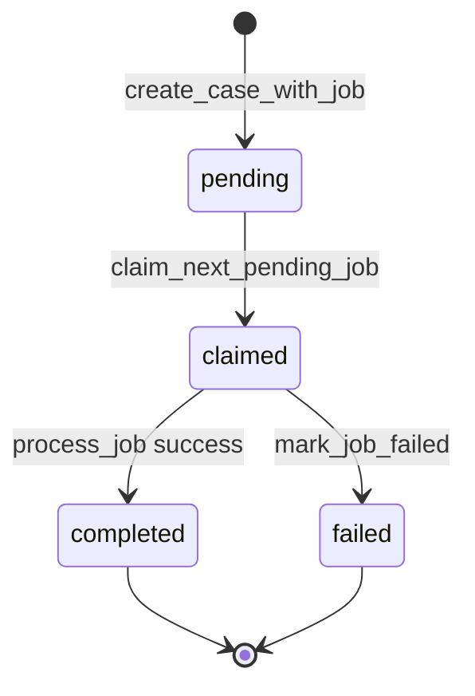

# Architecture — Tesla Model 3 Manual Q&A with RAG

## 1. Problem Statement and Users

### Problem

Tesla Model 3 owners need quick, accurate answers to questions about vehicle operation (e.g., "how to enable auto-lock on walk-away"). The official manual is a long PDF that is hard to search. A Retrieval-Augmented Generation (RAG) system can retrieve relevant manual passages and generate concise, cited answers.

### Primary Users

| User | Goal | Interaction |
|------|------|-------------|
| Vehicle owner | Ask a question about Model 3 operation | `POST /cases` with title + description as the question |
| Support engineer | Review AI-generated answers for accuracy | Query case state and AI output via `GET /cases/{id}` |
| Operator | Monitor system health and processing status | Health endpoints + Prometheus metrics |

### Core Value

The system accepts a natural-language question, retrieves relevant manual chunks via hybrid search (BM25 + dense/sparse vectors), reranks them, generates an answer with citation references, and persists the full result for audit and review.

---

## 2. Main Workflow

### Normal Path

1. **Client submits question** — `POST /cases` with `title` (short summary) and `description` (full question text)
2. **API creates Case** — persists a `cases` row with `status = queued`
3. **API creates Job** — persists a `jobs` row with `status = pending`, `job_type = triage_case`, linked via `case_id` FK
4. **Worker claims Job** — polls oldest pending job, sets `status = claimed`, increments `attempts`, records `claimed_at`
5. **Worker calls AI Service** — `POST /triage` with case title + description
6. **AI Service calls RAG Service** — `POST /rag/query` with the question as query text
7. **RAG retrieves and generates** — BM25 recall → Milvus hybrid search → merge/dedup → BGE-M3 rerank → LLM generates cited answer
8. **Worker writes back result** — sets `case.status = triaged`, `case.ai_label/ai_summary/ai_confidence` from RAG response; sets `job.status = completed`, records `completed_at`

### Exception Paths

| Trigger | Behavior | End State |
|---------|----------|-----------|
| RAG service unavailable | AI Service `/triage` raises HTTP 5xx | Worker catches exception → `mark_job_failed()` → `job.status = failed`, `case.status = failed`, `error` recorded |
| LLM API (Doubao) quota exhausted or timeout | RAG Service returns 5xx | Same as above |
| Milvus / MongoDB connection failure | RAG Service returns 5xx | Same as above |
| Invalid input (title < 3 chars) | API returns 422 validation error | No Case/Job created |

---

## 3. Architecture Diagram



### Component Inventory

| Component | Port | Technology | Responsibility |
|-----------|------|------------|----------------|
| API Service | 8000 | FastAPI + SQLAlchemy + Alembic | Accept questions, persist Case/Job, expose query endpoints |
| PostgreSQL | 5432 | Postgres 16 | Relational persistence for cases and jobs |
| Worker | — | Python polling loop | Claim pending jobs, call AI Service, write back results |
| AI Service | 8100 | FastAPI | Receive triage requests, forward to RAG, return structured result |
| RAG Service | 6001 | FastAPI (new) | Multi-route retrieval, reranking, LLM generation |
| MongoDB | 27017 | MongoDB 7.0 | Store manual document chunks and metadata |
| Milvus | 19530 | Milvus (embedded/standalone) | Dense + sparse vector index for BGE-M3 embeddings |
| BM25 Index | — | Pickle file (local) | Sparse keyword recall with jieba tokenization |
| LLM API | — | Doubao (OpenAI-compatible) | Generate cited answer from retrieved context |

---

## 4. Persistence Entities and Schema

### Existing Entities (from starter template)

#### `cases` table

Source: `services/common/models.py` L35-69, migration `alembic/versions/20260713_0001` L18-30

| Field | Type | Nullable | Key/Index | Default | Purpose |
|-------|------|----------|-----------|---------|---------|
| `id` | String(36) | NOT NULL | PK | `uuid4()` | Case unique ID |
| `title` | String(200) | NOT NULL | — | — | Question short title |
| `description` | Text | NOT NULL | — | — | Full question text |
| `status` | String(20) | NOT NULL | Index | `new` | Current processing state |
| `ai_label` | String(50) | NULL | — | — | RAG-derived category label |
| `ai_summary` | Text | NULL | — | — | RAG-generated answer (cited) |
| `ai_confidence` | Float | NULL | — | — | Retrieval/generation confidence (0.0-1.0) |
| `created_at` | DateTime(tz) | NOT NULL | — | `utcnow` | Creation timestamp |
| `updated_at` | DateTime(tz) | NOT NULL | — | `utcnow` + onupdate | Last modification timestamp |

#### `jobs` table

Source: `services/common/models.py` L72-113, migration L32-47

| Field | Type | Nullable | Key/Index | Default | Purpose |
|-------|------|----------|-----------|---------|---------|
| `id` | Integer | NOT NULL | PK, autoincrement | — | Job unique ID |
| `case_id` | String(36) | NOT NULL | Index, FK→`cases.id` (CASCADE) | — | Parent case reference |
| `job_type` | String(50) | NOT NULL | — | `triage_case` | Job processing type |
| `status` | String(20) | NOT NULL | Index | `pending` | Current job state |
| `attempts` | Integer | NOT NULL | — | `0` | Claim retry counter |
| `error` | Text | NULL | — | — | Failure error message (truncated 1000 chars) |
| `created_at` | DateTime(tz) | NOT NULL | — | `utcnow` | Creation timestamp |
| `claimed_at` | DateTime(tz) | NULL | — | — | Worker claim timestamp |
| `completed_at` | DateTime(tz) | NULL | — | — | Completion timestamp (success or failure) |
| `updated_at` | DateTime(tz) | NOT NULL | — | `utcnow` + onupdate | Last modification timestamp |

---

## 5. State Transition Table

### Case Status

Source: `services/common/models.py` L17-21 (`CaseStatus`)

| Current State | Event | Trigger Function | New State | File:Line |
|---------------|-------|-----------------|-----------|-----------|
| — | Case created | `create_case_with_job()` | `queued` | `services/api/app/main.py:49` |
| `queued` | AI triage succeeds | `process_job()` | `triaged` | `services/worker/app/main.py:92` |
| `queued` | AI triage fails | `mark_job_failed()` | `failed` | `services/worker/app/main.py:52` |


### Job Status

Source: `services/common/models.py` L24-28 (`JobStatus`)

| Current State | Event | Trigger Function | New State | File:Line |
|---------------|-------|-----------------|-----------|-----------|
| — | Job created | `create_case_with_job()` | `pending` | `services/api/app/main.py:57` |
| `pending` | Worker claims | `claim_next_pending_job()` | `claimed` | `services/worker/app/main.py:31` |
| `claimed` | Processing succeeds | `process_job()` | `completed` | `services/worker/app/main.py:97` |
| `claimed` | Processing fails | `mark_job_failed()` | `failed` | `services/worker/app/main.py:47` |



---

## 6. Worker and AI Plan

### Worker (existing, no change needed)

The worker (`services/worker/app/main.py`) operates an infinite polling loop:

| Function | File:Line | Responsibility |
|----------|-----------|---------------|
| `run_worker()` | L105-137 | Main loop: claim → process → sleep → repeat; catches exceptions and delegates to `mark_job_failed` |
| `claim_next_pending_job()` | L20-36 | Query oldest `pending` job, set `claimed`, increment `attempts`, record `claimed_at` |
| `process_job()` | L57-102 | Read Case data → call AI `/triage` → write back `case.ai_*` + `case.status=triaged` + `job.status=completed` |
| `mark_job_failed()` | L39-54 | Set `job.status=failed` + `error` + `case.status=failed` (cascading) |

Poll interval: 2 seconds (`WORKER_POLL_SECONDS` env var).

### AI Service — RAG Integration

The AI Service (`services/ai/app/main.py`) currently uses keyword-based `triage_text()`. Integration replaces this with RAG.

#### Removal of keyword matching

The following will be removed since RAG answers are manual-domain, not ticket-classification:

| Removed | File:Line | Reason |
|---------|-----------|--------|
| `LABEL_KEYWORDS` dict | `services/ai/app/main.py:20-25` | Categories (incident/access/billing/maintenance) irrelevant to manual Q&A |
| `shorten()` | L28-32 | Only used by `triage_text` |
| `triage_text()` | L35-50 | Replaced by RAG call |
| Unit tests `test_triage_access_case`, `test_triage_general_case` | `tests/unit/test_ai_service.py` | Test removed function |

#### New `triage()` route

```python
@app.post("/triage", response_model=TriageResponse)
def triage(payload: TriageRequest) -> TriageResponse:
    query = f"{payload.title} {payload.description}"
    resp = httpx.post(
        f"{settings.rag_service_url}/rag/query",
        json={"query": query, "topk": 5},
        timeout=settings.worker_request_timeout_seconds,
    )
    resp.raise_for_status()
    data = resp.json()
    return TriageResponse(
        label=data["label"],
        summary=data["answer"],
        confidence=data["confidence"],
    )
```

#### RAG Service (new — `RAG/src/server/rag_service.py`)

Encapsulates `infer.py` pipeline as an HTTP service:

| Pipeline Stage | Source Module | Action |
|----------------|---------------|--------|
| BM25 recall | `src/retriever/bm25_retriever.py` | Top-10 sparse keyword match (jieba tokenization) |
| Milvus hybrid search | `src/retriever/milvus_retriever.py` | Top-10 dense+sparse vector recall (BGE-M3, RRF fusion) |
| Merge/dedup | `src/utils.merge_docs()` | Combine BM25 + Milvus results, deduplicate |
| BGE-M3 rerank | `src/reranker/bge_m3_reranker.py` | Top-5 precision reordering |
| LLM generation | `src/client/llm_chat_client.request_chat()` | Generate cited answer from context |
| Post-processing | `src/utils.post_processing()` | Clean output, extract citations |

**Endpoint**: `POST /rag/query` → `{answer, label, confidence, sources}`

**Data stores**: MongoDB (document text), Milvus (BGE-M3 vectors), BM25 pickle index, LLM via Doubao API.

**Warmstart**: All retrievers and reranker models loaded at service startup (same as `infer.py` L14-18).

