# Architecture: Model 3 Manual Assistant

Team Odie, MAIE6000C. W07 implementation reviewed on 31 October 2026.

## System boundary and intended use

The system helps Model 3 owners find and understand instructions from one
provisioned Chinese owner's manual. It provides information support and source
links. It neither controls the car nor certifies instructions as safe for every
vehicle version. Candidate business users include owners and fleet drivers;
customer demand and willingness to pay have not been validated.

## Deployed components

| Component | Location / port | Responsibility | Implementation |
|---|---|---|---|
| Browser UI and API | Local Docker, 8000 | Accept questions, history, citations, retry | `services/api/app/main.py`, `services/api/web/` |
| PostgreSQL 16 | Local Docker, 5432 | Durable questions, job state and answer evidence | `services/common/models.py`, Alembic |
| Worker | Local Docker, no exposed port | Claim and execute jobs outside HTTP request | `services/worker/app/main.py` |
| AI HTTP gateway | Local Docker, 8100 | Validated remote RAG contract | `services/ai/app/main.py`, `services/common/rag_client.py` |
| SSH forwarding | Windows 6001 to AutoDL 6001 | Reach localhost-bound GPU gateway | `scripts/connect-rag.ps1` |
| RAG gateway | AutoDL, 127.0.0.1:6001 | Retrieval, reranking, generation, manual assets | `scripts/rag_gateway.py` copied as `maie_rag_gateway.py` |
| vLLM | AutoDL, 127.0.0.1:8000/v1 | Existing quantized Qwen3 model inference | `RAG/src/client/llm_local_client.py` |
| Knowledge stores | AutoDL | BM25 pickle, Milvus Lite `.db`, MongoDB chunks | `RAG/src/retriever/`, `RAG/src/fields/` |

```mermaid
flowchart LR
    UI[Browser] -->|POST /questions| API[FastAPI 8000]
    API -->|Commit question and job| DB[(PostgreSQL)]
    DB -->|Claim oldest pending| W[Worker]
    W -->|POST /rag/query| AI[AI gateway 8100]
    AI -->|HTTP over SSH tunnel| RAG[AutoDL RAG 6001]
    RAG --> RET[BM25 and Milvus Lite]
    RET --> RERANK[BGE reranker]
    RERANK --> LLM[vLLM Qwen3]
    LLM -->|Answer and evidence| RAG
    RAG --> AI
    AI --> W
    W -->|Persist answer, citations, terminal state| DB
    UI -->|GET /questions/id| API
    DB --> API
```

## Request and persistence contract

1. `POST /questions` validates 3–4000 characters through `QuestionCreate`.
2. One transaction inserts a `cases` row (`queued`) and a linked `jobs` row
   (`pending`, `job_type=answer_question`). HTTP 202 follows the commit.
3. The worker selects the oldest pending job with `FOR UPDATE SKIP LOCKED`.
   It sets `claimed`, `claimed_at`, increments `attempts`, and sets the question
   to `processing`. The transaction closes before the remote HTTP call.
4. The local AI gateway sends `{query, case_id}` to the remote RAG gateway.
5. The worker validates the returned schema and commits the answer together with
   `cite_pages`, source excerpts and image metadata. The question becomes
   `answered`; the job becomes `completed` with `completed_at`.
6. The UI polls saved state. The response is not streamed from the worker to the UI.

`cases` retains the legacy triage columns but manual answers use `answer`,
`cite_pages`, `sources`, and `related_images`. Migration
`20261023_0002_add_manual_answers.py` adds those fields without resetting history.

## State transitions and failure behavior

| Entity | Normal sequence | Failure and recovery |
|---|---|---|
| Manual question | queued, processing, answered | processing to failed; explicit retry returns it to queued |
| Job | pending, claimed, completed | claimed to failed; retry resets pending and attempts |

The remote HTTP deadline defaults to 180 seconds; the worker allows 15 additional
seconds. Exceptions produce a failed job and a user-facing error, without a
fabricated answer. `POST /questions/{id}/retry` returns 409 unless the question has
failed. A worker lease defaults to 300 seconds (at least HTTP deadline plus 60).
Abandoned claims requeue until the configured three-attempt limit; this is crash
recovery, not an automatic retry policy for every RAG error.

Remote generation is serialized with a lock. Concurrent inference receives 429.
The bounded in-memory cache uses `(case_id, query)` for up to 256 results / one hour.
The durable queue supports recovery, but the total distributed workflow does not
guarantee exactly-once inference. Cache entries disappear on gateway restart.

## Existing RAG pipeline

The wrapper reuses the pre-existing AutoDL modules without importing the blocking
top-level CLI loop. It requests BM25 top 10 and Milvus hybrid top 10, merges and
deduplicates candidates, selects BGE reranker top 5, and asks the existing local
Qwen3 endpoint for an answer. Post-processing resolves references to manual pages
and images. Vector retrieval is invoked, but useful hits and factual support must
be evaluated separately. Refer to `submissions/week07/evidence/autodl-source/` for
read-only snapshots of the actual remote core files and to `autodl-runtime.json`
for hashes. Local legacy files can differ in comments or formatting.

## Changes from the Week 04 proposal

| Week 04 proposal | W07 implementation and rationale |
|---|---|
| Replace `/triage` while keeping API/worker unchanged | Add a distinct `/questions` contract and job type so a cited manual answer is not forced into a triage label/confidence schema |
| Run RAG as another local Compose service | Reuse provisioned AutoDL GPU services through SSH; local Docker contains API, AI gateway, worker and PostgreSQL |
| Return answer as `ai_summary` | Persist answer, page references, source excerpts and image metadata as explicit fields |
| Refer to a hosted Doubao model | Actual answer generation uses the existing local vLLM Qwen3 int4 model |
| Treat Milvus as a network service | Current code connects to a Milvus Lite file; no separate port 19530 service is required |
| Focus on API integration | Deliver a browser interface, history, explicit failures, retry, and linked PDF evidence |

## Observability and remaining architecture risks

The API exposes liveness, SQL readiness, `/system/status`, request metrics and
structured request logs. The AI gateway exposes process health and RAG reachability.
Worker logs include `job_claimed`, case/job IDs and `job_completed`. Persisted job
timestamps support inspection of queue and processing time. Worker metrics and
distributed tracing are not yet implemented. Health endpoints alone do not prove
that the LLM will answer correctly or that all dependencies are healthy.

The main deployment risks are GPU availability, SSH lifecycle and single-worker
capacity. External deployment also needs authentication, data isolation, retention
policy and version-aware manual selection. Answer correctness and image relevance
remain unbenchmarked. The existing image association is based on retrieved pages.
