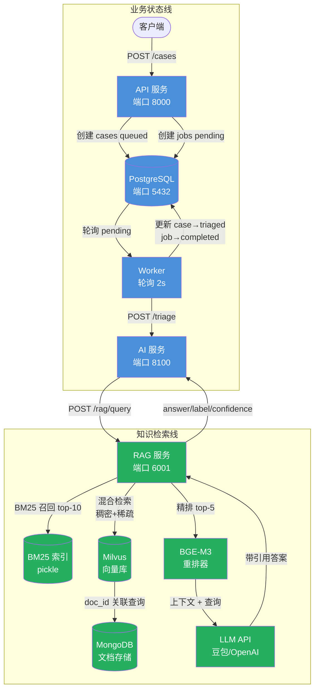
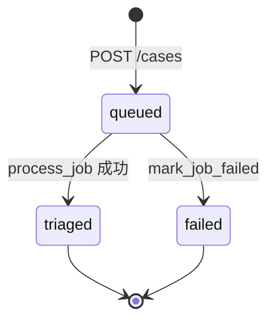
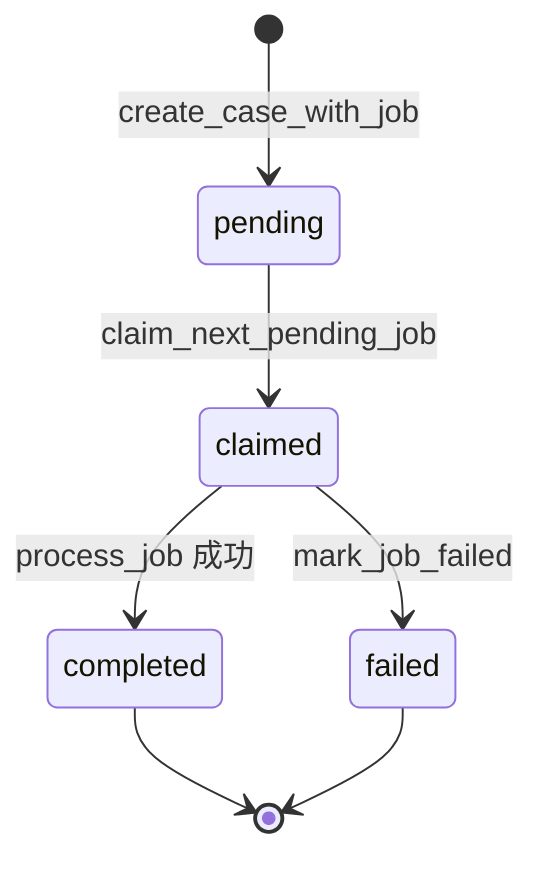

# 架构文档 — Tesla Model 3 手册问答系统（RAG）

## 1. 问题陈述与主要用户

### 问题

Tesla Model 3 车主需要快速、准确地获取车辆操作问题的答案（例如"如何开启离车自动上锁"）。官方手册是一份冗长的 PDF，检索困难。检索增强生成（RAG）系统可以检索相关手册段落，生成简洁且带引用的答案。

### 主要用户

| 用户 | 目标 | 交互方式 |
|------|------|---------|
| 车主 | 询问 Model 3 操作问题 | `POST /cases`，title 为问题摘要，description 为完整问题 |
| 支持工程师 | 审核 AI 生成的答案是否准确 | 通过 `GET /cases/{id}` 查询 case 状态和 AI 输出 |
| 运维人员 | 监控系统健康和处理状态 | 健康检查端点 + Prometheus 指标 |

### 核心价值

系统接收自然语言问题，通过混合检索（BM25 + 稠密/稀疏向量）召回相关手册段落，经精排重排后，由 LLM 生成带引用编号的答案，并将完整结果持久化以供审计和复核。

---

## 2. 主要工作流

### 正常路径

1. **客户端提交问题** — `POST /cases`，title 为简短摘要，description 为完整问题文本
2. **API 创建 Case** — 写入 `cases` 行，`status = queued`
3. **API 创建 Job** — 写入 `jobs` 行，`status = pending`，`job_type = triage_case`，通过 `case_id` 外键关联
4. **Worker 认领 Job** — 轮询最老的 pending job，设 `status = claimed`，`attempts` 递增，记录 `claimed_at`
5. **Worker 调用 AI 服务** — `POST /triage`，传入 case 的 title + description
6. **AI 服务调用 RAG 服务** — `POST /rag/query`，将问题作为查询文本发送
7. **RAG 检索并生成** — BM25 召回 → Milvus 混合检索 → 去重合并 → BGE-M3 精排 → LLM 生成带引用答案
8. **Worker 写回结果** — 设 `case.status = triaged`，写入 `ai_label`/`ai_summary`/`ai_confidence`；设 `job.status = completed`，记录 `completed_at`

### 异常路径

| 触发条件 | 行为 | 终态 |
|---------|------|------|
| RAG 服务不可用 | AI 服务 `/triage` 返回 HTTP 5xx | Worker 捕获异常 → `mark_job_failed()` → `job.status = failed`，`case.status = failed`，记录 `error` |
| LLM API（豆包）配额耗尽或超时 | RAG 服务返回 5xx | 同上 |
| Milvus / MongoDB 连接失败 | RAG 服务返回 5xx | 同上 |
| 输入非法（title < 3 字符） | API 返回 422 校验错误 | 不创建 Case/Job |

---

## 3. 架构图



### 组件清单

| 组件 | 端口 | 技术栈 | 职责 |
|------|------|--------|------|
| API 服务 | 8000 | FastAPI + SQLAlchemy + Alembic | 接收问题、持久化 Case/Job、提供查询端点 |
| PostgreSQL | 5432 | Postgres 16 | 关系型持久化，存储 cases 和 jobs |
| Worker | — | Python 轮询循环 | 认领 pending job、调用 AI 服务、写回结果 |
| AI 服务 | 8100 | FastAPI | 接收 triage 请求、转发至 RAG、返回结构化结果 |
| RAG 服务 | 6001 | FastAPI（新增） | 多路召回、重排、LLM 生成 |
| MongoDB | 27017 | MongoDB 7.0 | 存储手册文档分块和元数据 |
| Milvus | 19530 | Milvus（嵌入式/独立） | BGE-M3 稠密+稀疏向量索引 |
| BM25 索引 | — | Pickle 文件（本地） | 基于 jieba 分词的稀疏关键词召回 |
| LLM API | — | 豆包（OpenAI 兼容） | 基于检索上下文生成带引用的答案 |

---

## 4. 持久化实体与 Schema 说明

### 现有实体（来自 starter 模板）

#### `cases` 表

来源：`services/common/models.py` L35-69，迁移 `alembic/versions/20260713_0001` L18-30

| 字段 | 类型 | 可空 | 主键/索引 | 默认值 | 用途 |
|------|------|------|----------|--------|------|
| `id` | String(36) | NOT NULL | 主键 | `uuid4()` | Case 唯一 ID |
| `title` | String(200) | NOT NULL | — | — | 问题简短标题 |
| `description` | Text | NOT NULL | — | — | 完整问题文本 |
| `status` | String(20) | NOT NULL | 索引 | `new` | 当前处理状态 |
| `ai_label` | String(50) | NULL | — | — | RAG 推导的分类标签 |
| `ai_summary` | Text | NULL | — | — | RAG 生成的答案（带引用） |
| `ai_confidence` | Float | NULL | — | — | 检索/生成置信度（0.0-1.0） |
| `created_at` | DateTime(tz) | NOT NULL | — | `utcnow` | 创建时间戳 |
| `updated_at` | DateTime(tz) | NOT NULL | — | `utcnow` + onupdate | 最后修改时间戳 |

#### `jobs` 表

来源：`services/common/models.py` L72-113，迁移 L32-47

| 字段 | 类型 | 可空 | 主键/索引 | 默认值 | 用途 |
|------|------|------|----------|--------|------|
| `id` | Integer | NOT NULL | 主键，自增 | — | Job 唯一 ID |
| `case_id` | String(36) | NOT NULL | 索引，外键→`cases.id`（CASCADE） | — | 父 Case 引用 |
| `job_type` | String(50) | NOT NULL | — | `triage_case` | 任务处理类型 |
| `status` | String(20) | NOT NULL | 索引 | `pending` | 当前任务状态 |
| `attempts` | Integer | NOT NULL | — | `0` | 认领重试计数 |
| `error` | Text | NULL | — | — | 失败错误信息（截断 1000 字符） |
| `created_at` | DateTime(tz) | NOT NULL | — | `utcnow` | 创建时间戳 |
| `claimed_at` | DateTime(tz) | NULL | — | — | Worker 认领时间戳 |
| `completed_at` | DateTime(tz) | NULL | — | — | 完成时间戳（成功或失败） |
| `updated_at` | DateTime(tz) | NOT NULL | — | `utcnow` + onupdate | 最后修改时间戳 |

---

## 5. 状态转换表

### Case 状态

来源：`services/common/models.py` L17-21（`CaseStatus`）

| 当前状态 | 事件 | 触发函数 | 新状态 | 文件:行号 |
|---------|------|---------|--------|----------|
| — | Case 创建 | `create_case_with_job()` | `queued` | `services/api/app/main.py:49` |
| `queued` | AI 分诊成功 | `process_job()` | `triaged` | `services/worker/app/main.py:92` |
| `queued` | AI 分诊失败 | `mark_job_failed()` | `failed` | `services/worker/app/main.py:52` |


### Job 状态

来源：`services/common/models.py` L24-28（`JobStatus`）

| 当前状态 | 事件 | 触发函数 | 新状态 | 文件:行号 |
|---------|------|---------|--------|----------|
| — | Job 创建 | `create_case_with_job()` | `pending` | `services/api/app/main.py:57` |
| `pending` | Worker 认领 | `claim_next_pending_job()` | `claimed` | `services/worker/app/main.py:31` |
| `claimed` | 处理成功 | `process_job()` | `completed` | `services/worker/app/main.py:97` |
| `claimed` | 处理失败 | `mark_job_failed()` | `failed` | `services/worker/app/main.py:47` |



---

## 6. Worker 和 AI 计划

### Worker（现有，无需改动）

Worker（`services/worker/app/main.py`）运行无限轮询循环：

| 函数 | 文件:行号 | 职责 |
|------|----------|------|
| `run_worker()` | L105-137 | 主循环：认领 → 处理 → 休眠 → 重复；捕获异常并委托 `mark_job_failed` |
| `claim_next_pending_job()` | L20-36 | 查询最老 `pending` job，设 `claimed`，递增 `attempts`，记录 `claimed_at` |
| `process_job()` | L57-102 | 读取 Case 数据 → 调用 AI `/triage` → 写回 `case.ai_*` + `case.status=triaged` + `job.status=completed` |
| `mark_job_failed()` | L39-54 | 设 `job.status=failed` + `error` + `case.status=failed`（级联） |

轮询间隔：2 秒（`WORKER_POLL_SECONDS` 环境变量）。

### AI 服务 — RAG 集成路径

AI 服务（`services/ai/app/main.py`）当前使用关键词匹配 `triage_text()`。集成后替换为 RAG 调用。

#### 移除关键词匹配

以下内容将被移除，因为 RAG 面向手册问答，关键词分类（incident/access/billing/maintenance）无意义：

| 移除项 | 文件:行号 | 原因 |
|--------|----------|------|
| `LABEL_KEYWORDS` 字典 | `services/ai/app/main.py:20-25` | 分类标签与手册问答无关 |
| `shorten()` 函数 | L28-32 | 仅被 `triage_text` 使用 |
| `triage_text()` 函数 | L35-50 | 被 RAG 调用替代 |
| 单元测试 `test_triage_access_case`、`test_triage_general_case` | `tests/unit/test_ai_service.py` | 测试已移除的函数 |

#### 新的 `triage()` 路由

```python
@app.post("/triage", response_model=TriageResponse)
def triage(payload: TriageRequest) -> TriageResponse:
    query = f"{payload.title} {payload.description}"
    resp = httpx.post(
        f"{settings.rag_service_url}/rag/query",
        json={"query": query, "topk": 5},
        timeout=settings.worker_request_timeout_seconds,
    )
    resp.raise_for_status()
    data = resp.json()
    return TriageResponse(
        label=data["label"],
        summary=data["answer"],
        confidence=data["confidence"],
    )
```

#### RAG 服务（新增 — `RAG/src/server/rag_service.py`）

将 `infer.py` 管线封装为 HTTP 服务：

| 管线阶段 | 来源模块 | 动作 |
|---------|---------|------|
| BM25 召回 | `src/retriever/bm25_retriever.py` | Top-10 稀疏关键词匹配（jieba 分词） |
| Milvus 混合检索 | `src/retriever/milvus_retriever.py` | Top-10 稠密+稀疏向量召回（BGE-M3，RRF 融合） |
| 去重合并 | `src/utils.merge_docs()` | 合并 BM25 + Milvus 结果，去重 |
| BGE-M3 精排 | `src/reranker/bge_m3_reranker.py` | Top-5 精度重排 |
| LLM 生成 | `src/client/llm_chat_client.request_chat()` | 基于上下文生成带引用答案 |
| 后处理 | `src/utils.post_processing()` | 清理输出，提取引用 |

**端点**：`POST /rag/query` → `{answer, label, confidence, sources}`

**数据存储**：MongoDB（文档文本）、Milvus（BGE-M3 向量）、BM25 pickle 索引、LLM 经豆包 API 调用。

**预热**：所有检索器和重排模型在服务启动时加载（同 `infer.py` L14-18）。


