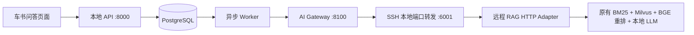

# 车书问答工程：运行与部署

> 本文保留 W07 部署背景。当前启动、任务恢复和证据格式请参考
> [当前升级说明](reliability-upgrade.md)。无需 AutoDL 的工程验证入口是
> CMD 中的 `scripts\start.cmd` 和 http://localhost:8020/app，结果会标记为模拟。

本地页面：http://localhost:8000/app 。浏览器不需要知道远程机器地址或模型密钥。

从 AutoDL 与本机都关闭的状态重新启动时，按 [完整启动流程](startup-zh.md) 操作；其中包含原有 `cd /root/autodl-tmp/RAG`、`source config.ini` 与 Windows CMD 命令。



## 1. 本地启动

在仓库根目录中执行，继续使用 `default` Docker context：

```powershell
# 首次运行才复制；已有 .env 不要覆盖。
if (-not (Test-Path .env)) { Copy-Item .env.example .env }
docker --context default compose up -d --build --wait
```

`.env` 中 `RAG_SERVICE_URL=http://host.docker.internal:6001` 使容器通过 Windows 上的 SSH 隧道连接远程 RAG。已有数据库数据卷会保留，API 启动时自动执行 Alembic 增量迁移。

页面、API、数据库可以在远程服务未启动时正常打开；页面会显示“车书服务未连接”。问答不会回退到关键词分类或生成示例答案。旧 `/cases` 和 `/triage` 接口仍保留，新的车书入口使用 `/questions` 和 `/rag/query`。

## 2. 准备远程环境

使用原来可以运行 `infer.py` 的 GPU 环境与同一份索引、模型和 `src` 代码。`scripts/rag_gateway.py` 不会导入 `infer.py`，避免触发其中的交互循环；它调用相同的 BM25、Milvus、BGE 重排、`request_chat` 和 `post_processing`。

在原有远程终端按 Ctrl+C 退出 **infer.py 问答循环**，以释放它占用的 GPU 重排模型。保留远程 LLM/vLLM 和 MongoDB 服务。当前 Milvus 为 Lite 文件模式，无需独立守护进程。然后执行 `which python`，记下这个环境的 Python 绝对路径。脚本额外只需要 `fastapi`、`uvicorn`，原 RAG requirements 已包含这两项。

**不要停止 LLM 服务器**：原来的 `request_chat` 仍连接远程机器本地的 `http://localhost:8000/v1`。

## 3. 上传服务并建立隧道

### CMD：直接运行 OpenSSH 命令

如果当前提示符是 `C:\Users\...>`，或系统禁止执行 `.ps1` 脚本，直接依次使用下面两条命令。替换 SSH 主机、端口与 Python 路径；这些命令不需要更改 PowerShell 执行策略：

```cmd
scp -P YOUR_SSH_PORT "E:\Users\PC\Desktop\maie6000c\scripts\rag_gateway.py" root@YOUR_SSH_HOST:/root/autodl-tmp/RAG/maie_rag_gateway.py
ssh -t -p YOUR_SSH_PORT -o ExitOnForwardFailure=yes -o ServerAliveInterval=30 -L 127.0.0.1:6001:127.0.0.1:6001 root@YOUR_SSH_HOST "/path/from/which/python /root/autodl-tmp/RAG/maie_rag_gateway.py --rag-dir /root/autodl-tmp/RAG --port 6001"
```

第一条上传文件，第二条运行接口并保持 SSH 隧道。两条命令均可能提示 SSH 密码；自行输入即可，密码不会显示。

### PowerShell：使用连接脚本

在 Windows 上打开一个新的 PowerShell，进入本仓库，运行：

```powershell
.\scripts\connect-rag.ps1 -SshHost YOUR_SSH_HOST -Port YOUR_SSH_PORT `
  -RagDir /root/autodl-tmp/RAG -RemotePython /path/from/which/python
```

脚本通过 scp 上传一个 `maie_rag_gateway.py` 文件，然后建立 SSH 隧道并运行网关。按提示自行输入 SSH 密码，不要把密码写入脚本或发送到聊天。私钥认证也可直接使用。脚本不修改原 `infer.py`、模型、索引或数据库。

远程接口只监听 `127.0.0.1:6001`；Windows 的转发也只监听本机。保持此 PowerShell 窗口打开，等待模型预热完成。页面在下一次连接检查时变为“车书服务已连接”。停止脚本会停止 HTTP 网关与隧道，不会停止原 LLM 或数据库。

若 Python 环境的默认解释器正确，可省略 `-RemotePython`。更换本地端口时同时修改 `.env` 中的 `RAG_SERVICE_URL`，再运行 `docker --context default compose up -d` 重建相关容器。

如需服务长期运行，可把 HTTP 网关交由 systemd/supervisor 管理，SSH 只使用 `-N -L 127.0.0.1:6001:127.0.0.1:6001` 转发。保持单个 Uvicorn worker，避免重复加载 GPU 模型；推理端串行执行以控制显存占用。

## 4. 验收实际问答

打开 `/app`，提问“Model 3 如何开启哨兵模式？在家停车时可以自动关闭吗？”。预期流程：

1. 问题保存至 PostgreSQL，状态从 `queued` 变为 `processing`。
2. Worker 调用 AI 网关，再通过隧道请求真实 RAG。
3. 答案、引用页码、原文摘录、相关图片保存回数据库，状态变为 `answered`。
4. 点击页码打开原 PDF 的对应页；历史记录刷新后仍可查看。
5. 断开 SSH 时，页面明确提示未连接；已提交任务失败后允许重试。

`cite_pages` 保留原 RAG 的 **PDF 页码（从 1 开始）**，可能与手册正文印刷页码不同。引用原文来自最终重排且实际被引用的文档，不把任意召回结果标为引用。不编造模型置信度。

## 接口

| 接口 | 用途 |
|---|---|
| `POST /questions` | `{ "question": "哨兵模式怎么用？" }`，返回 202 与任务编号 |
| `GET /questions` | 最近问答记录 |
| `GET /questions/{id}` | 轮询状态与最终答案 |
| `POST /questions/{id}/retry` | 重新执行失败任务 |
| `GET /system/status` | API、数据库、远程 RAG 就绪状态 |
| `GET /manual.pdf#page=115` | 通过本地 API 获取手册；片段由 PDF 阅读器处理 |
| `GET /manual-images/{id}` | 获取已引用图片，不暴露远程文件路径 |
| 远程 `POST /rag/query` | `{ "query": "…", "case_id": "…" }`，返回 answer/cite_pages/sources/related_images |

## 测试与故障处理

```powershell
docker --context default compose logs --tail 100 api ai worker
docker --context default compose exec api alembic current
```

开发测试使用 Python 3.11：`pip install -e ".[dev]"`，然后 `ruff check services scripts tests alembic` 与 `pytest -q tests/unit tests/integration`。

测试使用可控的 HTTP 响应验证接口契约、引用保存、超时、失败重试和 Worker 恢复；这些测试不代表远程 GPU 推理已验证。真实 RAG 验收需要上述远程连接可用后执行。

模型冷启动时状态未连接属于正常现象；若持续不可用，检查远程网关日志、SSH 转发、本地 6001 端口占用，以及 Docker 容器到 `host.docker.internal:6001` 的连通性。GPU 显存不足时先退出旧的 `infer.py` 进程，保持 LLM 服务运行。

问答推理默认最长等待 180 秒，Worker 租约默认 300 秒且始终长于 HTTP 等待时间。Worker 异常退出后的过期任务可重新入队，达到次数限制后明确失败。HTTP 网关缓存近期同一问题任务的结果，避免重试重复生成。

当前是单用户本地工程：没有用户隔离，历史记录对本机访问者可见。对外上线前应增加身份认证、访问限制、TLS 与数据保留策略；不要直接把这些本地端口开放到公网。
